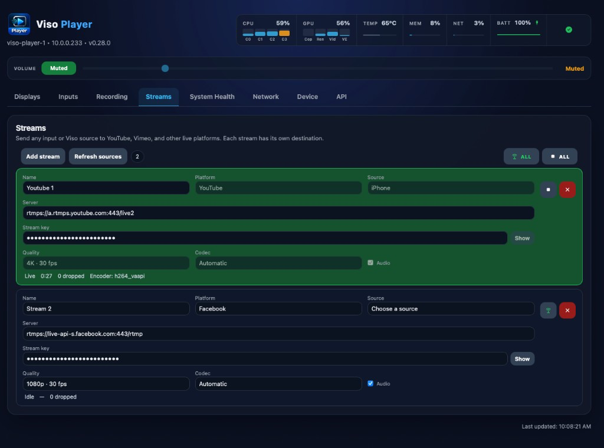
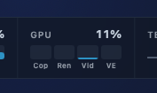

# Viso Player 0.29.0

Current USB image: **`viso-player-0.29.0.iso`**. Machines already on **0.24.0**, **0.25.0**, **0.26.0**, **0.26.1**, **0.27.0**, **0.27.1**, or **0.28.0** can apply this build from **Device → Updates**. Versions before 0.24.0 still need a USB install (see [v0.24.0](https://github.com/zabelez/viso-player-releases/releases/tag/v0.24.0)).

## What is new

  

- **Streams.** Send any input or Viso source to a live platform. YouTube, Twitch, Facebook, Kick, Trovo, and Vimeo fill in the server. TikTok, LinkedIn, X, and Custom RTMP take the server URL from that platform. Each stream is a card, with a name, a server, a stream key, a source, a codec, a quality, and audio. An input and a source can go out at the same time, and the same source can go to more than one destination. There is no limit on count. Start all and Stop all sit above the cards. A card turns green while that stream is live.
- **Picture and sound.** The platform receives H.264 with AAC. Quality is 720p, 1080p, or 4K at 30 fps, or Custom. The codec is Automatic, H.264 VA-API, H.264 Quick Sync, or H.264 software. Audio can be turned off.
- **The screen stays live.** An input is read from the capture picture. A Viso source is received on its own connection, so streaming does not take frames or sound away from a display. A destination that falls behind counts dropped frames on that stream and reconnects.
- **The key stays on the player.** Show and Hide reveal it on the card. It is not written to logs. Platform, server, key, source, codec, quality, and audio stay locked while that stream is live. The setup is kept across a reboot.

## Also in this version

- **Recorded files.** The list updates while a recording is running. A file that is still open shows In progress. Play stays off until the file is closed.
- **GPU.** The header shows each engine on the card: Copy, Render, Video, and Video Enhance. A live stream’s encoder is included in that reading.

  

## What you should see after installing

1. Write **`viso-player-0.29.0.iso`** (Balena Etcher, or Rufus in **DD Image** mode). Boot from USB.
2. A 15-second menu appears. If you do nothing, **Try** starts. To keep the player, choose **Install**, let it finish, and **remove the USB** when asked.
3. Displays start black — press **SPACE** for the address. Open `https://<IP>`, accept the certificate warning, and set the operator password.
4. **Streams → Add stream.** Choose a platform, paste the stream key, choose a source, then Start.

## Already on 0.24.0 through 0.28.0

Open **Device → Updates**, check, and apply **0.29.0**. You do not need to reinstall from USB unless you prefer a clean install.

## Downloads

| File | Purpose |
|------|---------|
| `viso-player-0.29.0.iso` | Try or Install. **Install erases the target disk.** |
| `viso-player-0.29.0.iso.sha256` | Verify the image |
| `viso-player-0.29.0.tar.gz` | In-place update for machines already on **0.24.0** through **0.28.0**. |
| `viso-player-0.29.0.tar.gz.sha256` | Verify the update package |
| `latest.json` / `latest.json.sig` | Signed update manifest for **Device → Updates**. |

| File | SHA-256 |
|------|---------|
| `viso-player-0.29.0.iso` | `7470425c195530ece80bb32b331fb131d729b2c3baa619a63720626899c60e29` |
| `viso-player-0.29.0.tar.gz` | `95257bfb99e05dd4a18479f950c8d6111fb21dd3b596858ccda473bfd761b651` |
